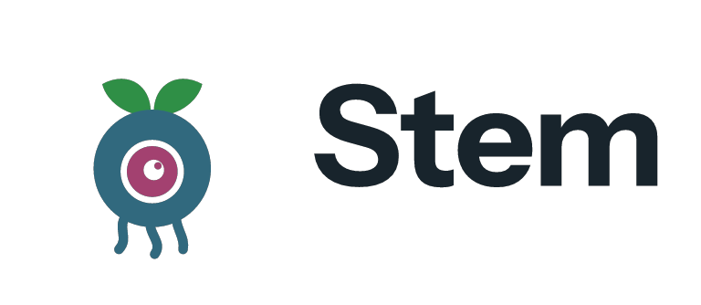
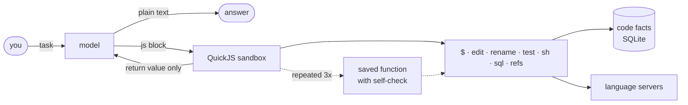

<p align="center">
  <picture>
    <source media="(prefers-color-scheme: dark)" srcset="brand/kit/animated/stem-lockup-dark-transparent.webp">
    
  </picture>
</p>

<p align="center"><b>A tiny coding agent that grows its own tools for your project.</b></p>

<p align="center">
  
  
  
  
</p>

---

## Start

```sh
cargo install --path core
stem login claude-native        # Claude Pro/Max, or put any key in ~/.stem/.env
cd your/project && stem
```

## How it works



| | |
|---|---|
| **One loop** | the model answers in text, or in one JavaScript block |
| **One object** | scripts see only `$`: no files, network or processes beyond it |
| **Small context** | only a script's return value goes back to the model |
| **Grows** | repeated snippets become named functions, checked before they are kept |
| **Prunes** | unused for 21 days or failing more than working: dropped |
| **Measured** | every turn, birth, use and drop goes to `.stem/sessions/*.jsonl` |

## What it knows

| Source | What | Speed |
|---|---|---|
| tree-sitter | symbols and references: TS, JS, Rust, Python, Go | 8,079 files in 3.9 s, then < 1 ms per query |
| git | commits and files that change together | same store |
| language servers | tsgo, ty, rust-analyzer, gopls, clangd, zls | one per sub-project root |

## Commands

| | |
|---|---|
| `stem` | the input; type `/` for the menu |
| `stem "task"` | one task, answer on stdout |
| `stem login claude-native` | Claude plan in the browser |
| `stem models [filter]` | models you can use now |
| `stem doctor` | model, key, project, servers |
| `stem stats` | cost, tokens, scripts |
| `stem js [file]` | run a script against `$`, no model |
| `stem mcp` | serve `$` as one MCP tool |

| In the input | |
|---|---|
| `/model opus` | switch model |
| `/effort high` | reasoning effort |
| `/cache 1h` | prompt cache TTL: `5m` or `1h` |
| `/yolo` | approvals off or on |
| `/status` · `/cost` · `/new` | state, spend, fresh start |

## Safety

| Asks first | Never asks |
|---|---|
| deleting files, `git reset --hard`, `stash`, `rebase`, `push`, `publish`, `DROP TABLE` | reads, edits, tests, scratch files in `/tmp` |

## More

[core/README.md](core/README.md) engine, flags, file map
