<picture><source media="(prefers-color-scheme: dark)" srcset="brand/readme/hero-dark.svg"></picture>

<div align="center">


</div>

<picture><source media="(prefers-color-scheme: dark)" srcset="brand/readme/terminal-dark.svg"></picture>

```sh
cargo install --path core
stem login claude-n          # your Claude plan, or any key in ~/.stem/.env
cd your/project && stem
```

<picture><source media="(prefers-color-scheme: dark)" srcset="brand/readme/loop-dark.svg"></picture>

- **One object.** Scripts see only `$`. No files, network or processes beyond it, so no approval pop-ups for reads and edits.
- **Small context.** A script can read a thousand files and return three lines. Only those three lines cost tokens.
- **Prompt cache first.** History is append-only, so every turn reuses the cache. `/cache 1h` for long sessions.

<picture><source media="(prefers-color-scheme: dark)" srcset="brand/readme/grow-dark.svg"></picture>

<picture><source media="(prefers-color-scheme: dark)" srcset="brand/readme/facts-dark.svg"></picture>

<picture><source media="(prefers-color-scheme: dark)" srcset="brand/readme/proof-dark.svg"></picture>

## Commands

| | |
|---|---|
| `stem` | the input; type `/` for the menu |
| `stem "task"` | one task, answer on stdout |
| `stem login claude-native` | Claude plan in the browser |
| `stem models [filter]` | models you can use now |
| `stem doctor` | model, key, project, servers |
| `stem stats` | cost, tokens, scripts |
| `stem js [file]` | run a script against `$`, no model |
| `stem mcp` | serve `$` as one MCP tool |

| In the input | |
|---|---|
| `/model opus` | switch model |
| `/effort high` | reasoning effort |
| `/cache 1h` | prompt cache TTL: `5m` or `1h` |
| `/yolo` | approvals off or on |
| `/status` · `/cost` · `/new` | state, spend, fresh start |

## Safety

| Asks first | Never asks |
|---|---|
| deleting files, `git reset --hard`, `stash`, `rebase`, `push`, `publish`, `DROP TABLE` | reads, edits, tests, scratch files in `/tmp` |

## More

[core/README.md](core/README.md) engine, flags, file map

<div align="center">
<br>


Sprout says hi.
</div>
